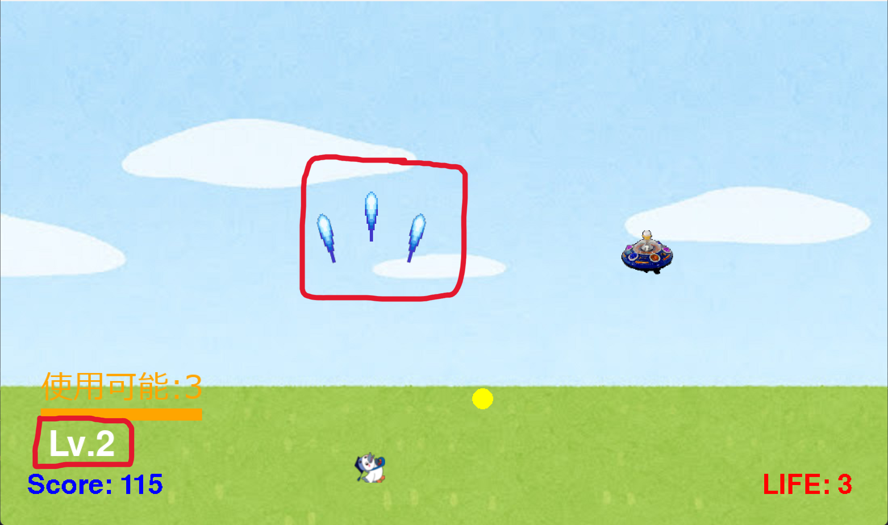
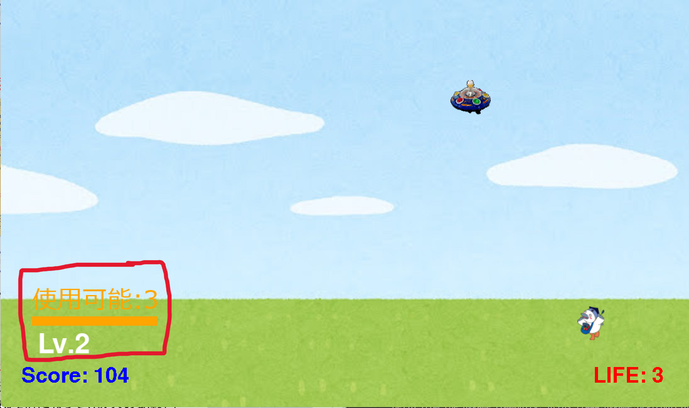
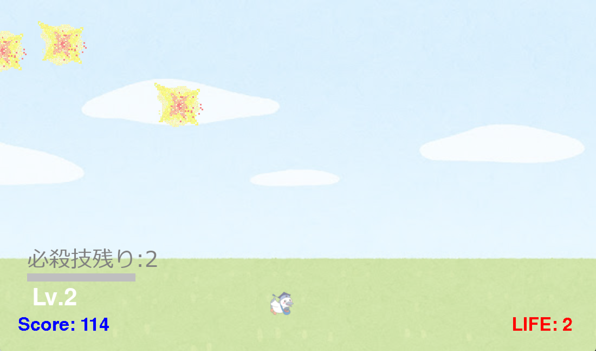

# こうかとん最終決戦

## 実行環境の必要条件
* python >= 3.10
* pygame >= 2.1
* 日本語の表示にフォント「メイリオ」「HG明朝B」を使っているため，Windowsでの実行を推奨

## ゲームの概要
* 主人公キャラクターこうかとんを操作し，ビームで雑魚敵を倒してスコアを稼ぎ，最後に登場するボスを倒すシューティングゲーム
* 授業で配布された「真・こうかとん無双」をベースにしている

## ゲームの遊び方
* タイトル画面でEnterキーを押すとゲームが始まる
* 矢印キーでこうかとんを操作し，スペースキーでこうかとんが向いている方向にビームを撃つ
* スコア0で1方向にビームを打てる。スコアが100(Lv2)と300(Lv3)でビームが3→5方向に強化される。

* 敵を10体倒すと、ゲージが溜まる。**Xキー**を押下して必殺技を使える。

* 雑魚敵や爆弾をビームで撃ち落とすとスコアが上がる
* スコアが700になるとボスが登場し，ボスのHPを0にするとクリアとなる
* 爆弾や敵に当たると残機が1減り，残機が0になるとゲームオーバーとなる
* クリア画面・ゲームオーバー画面でEnterキーを押すと，もう一度遊べる

### 操作方法
| キー | 操作 |
| --- | --- |
| ↑ ↓ ← → | こうかとんの移動（斜め移動も可） |
| Space | ビーム発射 |
| X | 必殺技（ゲージが満タンのとき，最大3回） |
| Enter | スタート・リトライ |

### スコアアップの方法
| 行動 | 点数 |
| --- | --- |
| 爆弾をビームで撃ち落とす | 1点 |
| 雑魚敵を倒す | 10点 |
| スコアアイテム（緑）を取る | 30点 |
| ボスを倒す | 500点 |

## ゲームの実装
### 共通基本機能
* 背景画像とこうかとんの描画，矢印キーによる移動，スペースキーによるビーム発射
* 雑魚敵の出現と爆弾投下，爆発エフェクト，スコア表示
* 残機（初期値3）の表示と，爆弾に当たったときの減少
* ビームの威力（`Beam.power`）と雑魚敵の体力（`Enemy.hp`，`Enemy.take_damage`）
* ゲームの状態（`state`）による通常プレイとボス戦の切り替え

### 分担追加機能
* ボス戦（担当：中川）：スコア700で登場し，HPに応じて攻撃が変化するボスと，画面上部のHPバーに関するクラス
    * HP50%より多い：こうかとんを狙って撃つ／50%以下：扇状に5発撃つ／20%以下：左右の揺れが速くなる
    * HPバーは残りHPに応じて緑→黄→赤に変化する
* アイテムドロップ（担当：栗原）：倒した雑魚敵から回復(赤)・威力アップ(黄)・スコア(緑)のアイテムが落ちる機能。回復をとったらLIFEが1増え、5からは増えない。威力アップをとったらビームの威力が1上がる。スコアをとったらスコアが30増える。
* 自機強化（担当：仙田）：スコアに応じてビームが3方向・5方向に強化され，ゲージを溜めて必殺技を撃てる機能
* 雑魚敵バリエーション・難易度上昇（担当：アルネヤディサーレム）：ジグザグ・追いかけ・硬い敵の3種類と，スコアに応じて出現が増える機能
    * ZigzagEnemy：左右にジグザグ移動する敵機を追加
    * ChaseEnemy：こうかとんを追いかける敵機を追加
    * TankEnemy：体力が3ある硬い敵機を追加し，体力バーを表示
    * スコアに応じて敵機の種類を増やす
    * スコアに応じて敵機の出現間隔を短くする
    * スコアに応じて爆弾の移動速度を上げる
    * 敵機ごとに異なる間隔で爆弾を投下する
    * スコアに応じて爆弾の投下間隔を短くする
* 画面遷移・サウンド（担当：田邉）：タイトル・クリア・ゲームオーバー画面とリトライ，BGMと効果音に関する機能

### BGM及び効果音の出典
* ビーム：効果音ラボ ビーム https://soundeffect-lab.info/sound/battle/battle2.html
* ダメージ：効果音ラボ パンチを受け止める https://soundeffect-lab.info/sound/battle/
* タイトルBGM：甘茶の音楽工房 ピコピコディスコ https://amachamusic.chagasi.com/music_picopicodisco.html
* ボス戦BGM：甘茶の音楽工房 イカロスの墜落 https://amachamusic.chagasi.com/music_icarusnotsuiraku.html

### メモ
* main.pyの中に `【中川】` `【栗原】` `【仙田】` `【サーレム】` `【田邉】` の印がある。自分の印をCtrl+Fで検索すると，コードを書く場所が分かる
* 「敵が倒れた瞬間」の処理は，main関数の中の `ここが「敵が倒れた瞬間」` と書いてある場所にまとめる
* ゲームの状態はmain関数内の変数 `state` で管理する（"title"，"play"，"boss"，"clear"，"gameover"）
* Groupの名前：beams（ビーム），bombs（敵の弾，ボスの弾も入れる），emys（雑魚敵，サブクラスも入れる），exps（爆発），items（アイテム），bosses（ボス）
* スコアは `score.value`，残機は `bird.life` を直接増減する
* 雑魚敵へのダメージは `emy.take_damage(beam.power)`，ボスへのダメージは `boss.take_damage(beam.power)` で与える
* ビームの威力アップは `power` を+1する（アイテムと自機強化で重ねても壊れないように）
* キー割り当て：矢印キー（移動），スペース（ビーム），X（必殺技），Enter（スタート・リトライ），Esc（終了）。これ以外のキーを使う場合はグループで相談する
* 画面の配置：上部（y=0〜60）はボスのHPバー，左下はスコアと強化段階・ゲージ，右下は残機
* 定数はファイル冒頭にまとめ，全ての関数・メソッドに型ヒントとdocstringを書く
* リトライ時に初期化が必要な変数を作ったら，田邉に伝える